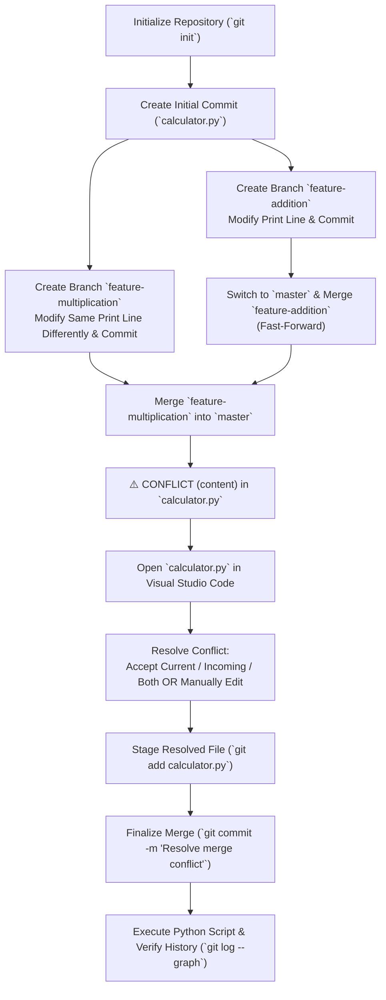

# Experiment 1: Git Merge Conflict Demonstration and Resolution

**Visual Studio Code + Git + Python Practical / Lab Manual**

---

## 1. Objective

Demonstrate how a Git merge conflict is created when two branches modify the same line of code, identify and inspect the conflict in Visual Studio Code, resolve the conflict, commit the resolution, and verify the repository history and final program output.

---

## 2. Environment & System Configuration

| Component | Configuration / Specification |
| :--- | :--- |
| **Operating System** | macOS / Linux / Windows 10/11 |
| **Code Editor** | Visual Studio Code |
| **Version Control** | Git |
| **Programming Language** | Python 3.x |
| **Terminal** | VS Code Integrated Terminal (`zsh`, `bash`, or PowerShell) |
| **Repository Name** | `git-merge-demo` |
| **Initial Branch** | `master` (or `main`, depending on Git default) |
| **Feature Branches** | `feature-addition`, `feature-multiplication` |
| **File Name** | `calculator.py` |

---

## 3. Prerequisites and Installation

Install Git, Visual Studio Code, and Python 3. Verify each installation from the terminal:

```bash
git --version
python3 --version   # or python --version
code --version
```

> **Note:** If any command is not recognized, install the corresponding software, verify your system `PATH` variables, and restart VS Code.

---

## 4. Step-by-Step Procedure

### Step 1: Create the Project Folder

Create a dedicated workspace directory and launch VS Code inside it:

```bash
mkdir git-merge-demo
cd git-merge-demo
code .
```

---

### Step 2: Initialize the Git Repository

Initialize a new local Git repository and check its status:

```bash
git init
git status
```

> **Note:** If your Git defaults to `main` instead of `master`, use `main` in all subsequent commands wherever `master` is referenced.

---

### Step 3: Create the Initial Python Program

1. Create a file named `calculator.py`.
2. Add the following Python code:

```python
def calculate(a, b):
    return a + b

print(calculate(10, 5))
```

3. Stage and commit the file:

```bash
git add calculator.py
git commit -m "Initial calculator program"
git status
```

---

### Step 4: Create Branch 1 (`feature-addition`)

1. Create and switch to the `feature-addition` branch:

```bash
git branch feature-addition
git switch feature-addition
git branch
```

2. Modify **only** the print statement in `calculator.py`:

```python
def calculate(a, b):
    return a + b

print("Addition:", calculate(10, 5))
```

3. Stage and commit the modification:

```bash
git add calculator.py
git commit -m "Update output for addition"
```

---

### Step 5: Create Branch 2 (`feature-multiplication`)

1. Switch back to the base branch (`master` or `main`):

```bash
git switch master
```

2. Create and switch to the `feature-multiplication` branch:

```bash
git branch feature-multiplication
git switch feature-multiplication
```

3. Modify the **exact same print line** differently:

```python
def calculate(a, b):
    return a + b

print("Result:", calculate(10, 5))
```

4. Stage and commit the change:

```bash
git add calculator.py
git commit -m "Change result message"
```

---

### Step 6: Create the Merge Conflict

1. Switch back to `master` (or `main`):

```bash
git switch master
```

2. Merge the first feature branch (`feature-addition`). This will succeed smoothly as a fast-forward merge:

```bash
git merge feature-addition
```

3. Merge the second feature branch (`feature-multiplication`):

```bash
git merge feature-multiplication
```

#### Observed Output:
The second merge will fail with a content conflict because both branches altered the same line of code from the same base commit:

```text
Auto-merging calculator.py
CONFLICT (content): Merge conflict in calculator.py
Automatic merge failed; fix conflicts and then commit the result.
```

---

### Step 7: Inspect the Conflict in Visual Studio Code

Open `calculator.py` in VS Code. The editor highlights the conflict with inline decoration and shows conflict resolution buttons (**Accept Current Change**, **Accept Incoming Change**, **Accept Both Changes**, **Compare Changes**).

The file content appears with Git conflict markers:

```python
def calculate(a, b):
    return a + b

<<<<<<< HEAD
print("Addition:", calculate(10, 5))
=======
print("Result:", calculate(10, 5))
>>>>>>> feature-multiplication
```

---

### Step 8: Understand the Conflict Markers

| Marker | Description |
| :--- | :--- |
| `<<<<<<< HEAD` | Denotes the start of the changes from the current branch (`master`). |
| `=======` | Divides the current branch's changes from the incoming branch's changes. |
| `>>>>>>> feature-multiplication` | Denotes the end of the incoming branch's changes. |

---

### Step 9: Resolve the Conflict Using VS Code

Select one of the resolution strategies:

* **Method A — Accept Current Change**: Retains the version currently on `master` (`"Addition:"`).
* **Method B — Accept Incoming Change**: Retains the version from `feature-multiplication` (`"Result:"`).
* **Method C — Accept Both Changes**: Retains both lines in sequence.
* **Method D — Manual Resolution (Recommended for this Lab)**:
  Manually edit the file, remove all conflict markers (`<<<<<<<`, `=======`, `>>>>>>>`), and define the desired combined logic:

```python
def calculate(a, b):
    return a + b

print("Calculation result:", calculate(10, 5))
```

> **Important:** Ensure that no marker syntax (`<<<<<<<`, `=======`, `>>>>>>>`) remains in the file.

---

### Step 10: Mark the Conflict as Resolved

1. Check the repository state:

```bash
git status
```

2. Stage the resolved file:

```bash
git add calculator.py
git status
```

> Staging the conflicted file with `git add` informs Git that the merge conflict has been resolved.

---

### Step 11: Complete the Merge Commit

Commit the resolution to conclude the merge process:

```bash
git commit -m "Resolve merge conflict"
git status
```

---

### Step 12: Test the Python Program

Run the script to verify syntactic correctness and proper execution:

```bash
python3 calculator.py   # or python calculator.py
```

#### Expected Output:
```text
Calculation result: 15
```

---

### Step 13: Verify the Git History

Inspect the revision graph and commit tree:

```bash
git log --oneline --graph --all
```

#### Verification:
The output graph clearly illustrates:
1. The initial commit on the root branch.
2. The diverging commits on `feature-addition` and `feature-multiplication`.
3. The merge commit that brought both branches back together into `master`.

---

## 5. Complete Lab Workflow



---

## 6. Useful Git Commands Reference

| Command | Purpose |
| :--- | :--- |
| `git status` | Displays the status of working tree and staging area, including conflict details |
| `git branch` | Lists all local branches in the repository |
| `git switch <branch>` | Switches to the specified branch |
| `git merge <branch>` | Merges specified branch into the current checked-out branch |
| `git diff` | Shows differences between working directory, staging area, or commits |
| `git add <file>` | Stages changes; marks conflicted files as resolved |
| `git commit` | Records changes to the repository; completes merge resolution |
| `git log --oneline --graph --all` | Displays graphical branch and commit history across all branches |
| `git merge --abort` | Aborts an in-progress merge conflict and resets to the pre-merge state |

---

## 7. Troubleshooting

| Issue / Error | Cause | Recommended Solution |
| :--- | :--- | :--- |
| **`fatal: invalid reference: master`** | Git default branch is set to `main`. | Run `git branch` to confirm the default branch name. Use `main` instead of `master`. |
| **VS Code does not display conflict action buttons** | Language / editor extension latency or plain text view. | Manually delete conflict markers (`<<<<<<<`, `=======`, `>>>>>>>`), save the file, or open the **Source Control** side panel to view conflicts. |
| **`python` command not recognized** | Python is missing from system `PATH`. | Run `python3` instead of `python`, or select the Python interpreter in VS Code (`Cmd/Ctrl + Shift + P` -> `Python: Select Interpreter`). |
| **Merge output shows `Already up to date`** | Branches were not diverged properly or changes were committed on the wrong branch. | Ensure both branches branched from the same commit and made different edits to the same lines before merging. |

---

## 8. Student Exercise / Assessment

### Task:
1. Create two new feature branches named `feature-ui` and `feature-output`.
2. Edit the same line in a source file on both branches with different content and commit each.
3. Merge both branches into your main branch to produce a merge conflict.
4. Resolve the conflict using Visual Studio Code and commit the resolution.

### Evidence / Deliverables to Submit:
1. **Branch List**: Terminal output of `git branch` displaying all feature branches.
2. **Conflict Screenshot**: Visual Studio Code editor displaying inline conflict markers (`<<<<<<<`, `=======`, `>>>>>>>`).
3. **Resolved File Screenshot**: Editor view showing the clean file with conflict markers removed.
4. **Git Status Output**: Terminal capture of `git status` after staging the resolution (`git add`).
5. **Commit History Graph**: Terminal capture of `git log --oneline --graph --all`.
6. **Program Output**: Terminal execution result demonstrating expected output of the resolved program.

---

## 9. Learning Outcomes

Upon successful completion of this practical experiment, students will be able to:
1. Create, manage, and switch between Git branches.
2. Understand the mechanics of how and why Git merge conflicts occur.
3. Inspect and interpret standard Git conflict markers (`HEAD`, separator, incoming branch).
4. Resolve conflicts using Visual Studio Code's visual merge tools as well as manual editing.
5. Stage resolved files and finalize merge commits.
6. Trace and audit branching and merge history using `git log --graph`.

