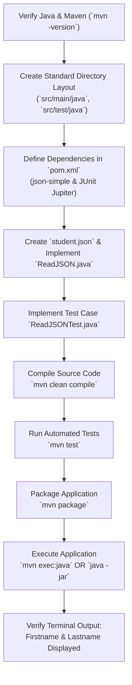

# Experiment 2: Automated Build and Dependency Management using Apache Maven

**Practical / Lab Manual: Constructing Standard Project Structure, Managing External Dependencies via `pom.xml`, and Automating Build Lifecycle**

---

## 1. Objective

To construct a standard Apache Maven Java project structure, manage third-party external dependencies (specifically `json-simple` for JSON processing and `JUnit 5` for testing) declaratively through `pom.xml`, and automate the full build lifecycle—including validation, compilation, automated unit testing, packaging into a deployable JAR artifact, and application execution.

---

## 2. Environment & System Configuration

| Component | Configuration / Specification |
| :--- | :--- |
| **Operating System** | macOS / Linux / Windows 10/11 |
| **JDK (Java Development Kit)** | Java SE 8, 11, 17, or 21 |
| **Build Automation Tool** | Apache Maven 3.8+ / 3.9+ |
| **Code Editor / IDE** | Visual Studio Code / IntelliJ IDEA / Eclipse |
| **Project Name / Artifact** | `maven-json-demo` |
| **Primary Dependency** | `com.googlecode.json-simple:json-simple:1.1.1` |
| **Testing Framework** | `org.junit.jupiter:junit-jupiter:5.10.0` |
| **Main Class** | `ReadJSON.java` |
| **Data File** | `student.json` |
| **Output Artifact** | `target/maven-json-demo-1.0-SNAPSHOT.jar` |

---

## 3. Background Theory & Maven Architecture

### 3.1 What is Apache Maven?
Apache Maven is a build automation and software project management tool primarily used for Java applications. Based on the concept of a **Project Object Model (POM)**, Maven manages a project's build, reporting, and documentation from a central configuration file.

### 3.2 Project Object Model (`pom.xml`)
The `pom.xml` file is the fundamental unit of work in Maven. It contains:
- **Project Identity**: `groupId`, `artifactId`, `version` (known as GAV coordinates).
- **Dependencies**: External libraries retrieved automatically from repositories.
- **Build Configurations & Plugins**: Compilers, test runners, and packagers.

### 3.3 Maven Repositories
Maven searches for and retrieves required libraries through a three-tier repository architecture:
1. **Local Repository (`~/.m2/repository`)**: Cached on the developer's local machine for quick access.
2. **Central Repository (`https://repo.maven.apache.org/maven2`)**: The public official repository maintained by the Maven community.
3. **Remote / Internal Repository**: Private enterprise repositories (e.g., Nexus, Artifactory) used within organizations.

```text
Dependency Lookup Flow:
Check Local Repository (~/.m2)
       │
       ▼ (if missing)
Download from Central/Remote Repository
       │
       ▼
Cache in Local Repository (~/.m2)
       │
       ▼
Include in Application Classpath during Build
```

### 3.4 Standard Maven Project Structure
Maven enforces a **convention-over-configuration** standard folder hierarchy:

```text
maven-json-demo/
├── pom.xml                                 # Central Project Configuration
├── student.json                            # Input JSON Data File
└── src/
    ├── main/
    │   ├── java/
    │   │   └── ReadJSON.java               # Application Source Code
    │   └── resources/                      # Application Configurations & Assets
    └── test/
        ├── java/
        │   └── ReadJSONTest.java           # Unit Test Source Code
        └── resources/                      # Test Configuration & Fixtures
```

### 3.5 Maven Build Lifecycle Phases
When a target phase is called, Maven automatically executes all preceding phases in sequence:

| Phase | Description |
| :--- | :--- |
| **`validate`** | Validates that the project structure is correct and all required information is available. |
| **`compile`** | Compiles the source code of the project (`src/main/java` -> `target/classes`). |
| **`test`** | Runs unit tests using a testing framework (e.g., JUnit) without packaging (`target/test-classes`). |
| **`package`** | Takes the compiled code and packages it into its distributable format (e.g., JAR, WAR). |
| **`verify`** | Runs checks on results of integration tests to ensure quality criteria are met. |
| **`install`** | Installs the generated package into the local repository (`~/.m2/repository`) for local use. |
| **`deploy`** | Copies the final package to the remote repository for sharing with other developers. |

---

## 4. Prerequisites and Verification

Ensure both Java Development Kit (JDK) and Apache Maven are installed and available on your system `PATH`:

```bash
# Check Java version (Compiler & Runtime)
java -version
javac -version

# Check Apache Maven version
mvn -version
```

#### Expected Output:
```text
Apache Maven 3.9.x (...)
Maven home: /opt/apache-maven-3.9.x
Java version: 17.x.x, vendor: Oracle Corporation / Eclipse Adoptium
```

---

## 5. Step-by-Step Implementation

### Step 1: Create the Project Directory Hierarchy

Open a terminal or command prompt and create the standard Maven project folder structure:

```bash
mkdir -p maven-json-demo/src/main/java
mkdir -p maven-json-demo/src/main/resources
mkdir -p maven-json-demo/src/test/java
mkdir -p maven-json-demo/src/test/resources

cd maven-json-demo
code .
```

---

### Step 2: Configure `pom.xml`

Create a `pom.xml` file in the root of the project directory. Add the project coordinates, declare the `json-simple` library and JUnit 5 dependencies, and configure the compiler and execution plugins:

```xml
<?xml version="1.0" encoding="UTF-8"?>
<project xmlns="http://maven.apache.org/POM/4.0.0"
         xmlns:xsi="http://www.w3.org/2001/XMLSchema-instance"
         xsi:schemaLocation="http://maven.apache.org/POM/4.0.0 
         http://maven.apache.org/xsd/maven-4.0.0.xsd">
    <modelVersion>4.0.0</modelVersion>

    <!-- Project Coordinates -->
    <groupId>com.example</groupId>
    <artifactId>maven-json-demo</artifactId>
    <version>1.0-SNAPSHOT</version>
    <packaging>jar</packaging>

    <name>maven-json-demo</name>

    <properties>
        <project.build.sourceEncoding>UTF-8</project.build.sourceEncoding>
        <maven.compiler.source>17</maven.compiler.source>
        <maven.compiler.target>17</maven.compiler.target>
    </properties>

    <dependencies>
        <!-- JSON.simple Library for JSON Parsing -->
        <dependency>
            <groupId>com.googlecode.json-simple</groupId>
            <artifactId>json-simple</artifactId>
            <version>1.1.1</version>
        </dependency>

        <!-- JUnit 5 Jupiter for Unit Testing -->
        <dependency>
            <groupId>org.junit.jupiter</groupId>
            <artifactId>junit-jupiter</artifactId>
            <version>5.10.0</version>
            <scope>test</scope>
        </dependency>
    </dependencies>

    <build>
        <plugins>
            <!-- Maven Compiler Plugin -->
            <plugin>
                <groupId>org.apache.maven.plugins</groupId>
                <artifactId>maven-compiler-plugin</artifactId>
                <version>3.11.0</version>
                <configuration>
                    <source>17</source>
                    <target>17</target>
                </configuration>
            </plugin>

            <!-- Maven Surefire Plugin for running tests -->
            <plugin>
                <groupId>org.apache.maven.plugins</groupId>
                <artifactId>maven-surefire-plugin</artifactId>
                <version>3.1.2</version>
            </plugin>

            <!-- Exec Maven Plugin to run main class directly via mvn -->
            <plugin>
                <groupId>org.codehaus.mojo</groupId>
                <artifactId>exec-maven-plugin</artifactId>
                <version>3.1.0</version>
                <configuration>
                    <mainClass>ReadJSON</mainClass>
                </configuration>
            </plugin>

            <!-- Maven Assembly Plugin to create executable fat-JAR with dependencies -->
            <plugin>
                <groupId>org.apache.maven.plugins</groupId>
                <artifactId>maven-assembly-plugin</artifactId>
                <version>3.6.0</version>
                <configuration>
                    <archive>
                        <manifest>
                            <mainClass>ReadJSON</mainClass>
                        </manifest>
                    </archive>
                    <descriptorRefs>
                        <descriptorRef>jar-with-dependencies</descriptorRef>
                    </descriptorRefs>
                </configuration>
                <executions>
                    <execution>
                        <id>make-assembly</id>
                        <phase>package</phase>
                        <goals>
                            <goal>single</goal>
                        </goals>
                    </execution>
                </executions>
            </plugin>
        </plugins>
    </build>
</project>
```

---

### Step 3: Create the Input Data File (`student.json`)

Create `student.json` in the root directory of `maven-json-demo`:

```json
{
  "fname": "Karthik",
  "lname": "Mallya",
  "branch": "Computer Science",
  "semester": 6
}
```

---

### Step 4: Create the Java Source Code (`ReadJSON.java`)

Create `src/main/java/ReadJSON.java`:

```java
import java.io.FileReader;
import java.io.IOException;

import org.json.simple.JSONObject;
import org.json.simple.parser.JSONParser;
import org.json.simple.parser.ParseException;

public class ReadJSON {

    public static void main(String[] args)
            throws IOException, ParseException {

        JSONParser jsonparser = new JSONParser();

        FileReader reader = 
                new FileReader("student.json");

        Object obj = jsonparser.parse(reader);

        JSONObject studentobj = (JSONObject) obj;

        String fname = (String) studentobj.get("fname");
        String lname = (String) studentobj.get("lname");

        System.out.println("Firstname : " + fname);
        System.out.println("Lastname : " + lname);

        reader.close();
    }
}
```

---

### Step 5: Create the Unit Test (`ReadJSONTest.java`)

To demonstrate automated unit testing in the Maven lifecycle, create `src/test/java/ReadJSONTest.java`:

```java
import static org.junit.jupiter.api.Assertions.*;

import java.io.StringReader;
import org.json.simple.JSONObject;
import org.json.simple.parser.JSONParser;
import org.junit.jupiter.api.Test;

public class ReadJSONTest {

    @Test
    void testJsonParsing() throws Exception {
        String mockJson = "{\"fname\": \"Karthik\", \"lname\": \"Mallya\"}";
        JSONParser parser = new JSONParser();
        Object obj = parser.parse(new StringReader(mockJson));

        assertNotNull(obj, "Parsed object should not be null");
        assertTrue(obj instanceof JSONObject, "Object should be an instance of JSONObject");

        JSONObject jsonObj = (JSONObject) obj;
        assertEquals("Karthik", jsonObj.get("fname"), "First name should match");
        assertEquals("Mallya", jsonObj.get("lname"), "Last name should match");
    }
}
```

---

### Step 6: Clean Previous Builds and Compile Source Code

Run the Maven clean and compile phases:

```bash
mvn clean compile
```

#### What Maven Performs:
1. Deletes any existing `target/` directory (`clean`).
2. Checks local repository `~/.m2/repository` for `json-simple-1.1.1.jar`. If absent, automatically downloads it from Maven Central.
3. Compiles `src/main/java/ReadJSON.java`.
4. Saves compiled `.class` bytecode to `target/classes/ReadJSON.class`.

```text
[INFO] --- clean:3.2.0:clean (default-clean) @ maven-json-demo ---
[INFO] --- resources:3.3.1:resources (default-resources) @ maven-json-demo ---
[INFO] --- compiler:3.11.0:compile (default-compile) @ maven-json-demo ---
[INFO] Compiling 1 source file with javac [debug target 17] to target/classes
[INFO] BUILD SUCCESS
```

---

### Step 7: Run Automated Unit Tests

Execute the unit testing phase:

```bash
mvn test
```

#### What Maven Performs:
1. Compiles unit test code in `src/test/java` into `target/test-classes`.
2. The **Maven Surefire Plugin** discovers and runs `ReadJSONTest.java`.
3. Test reports and execution logs are generated in `target/surefire-reports/`.

```text
[INFO] --- surefire:3.1.2:test (default-test) @ maven-json-demo ---
[INFO] Running ReadJSONTest
[INFO] Tests run: 1, Failures: 0, Errors: 0, Skipped: 0, Time elapsed: 0.052 s
[INFO] BUILD SUCCESS
```

---

### Step 8: Package the Application into a JAR Artifact

Package the project:

```bash
mvn package
```

#### Output Artifacts Created in `target/`:
* `target/maven-json-demo-1.0-SNAPSHOT.jar` (Standard compiled project JAR)
* `target/maven-json-demo-1.0-SNAPSHOT-jar-with-dependencies.jar` (Fat/Uber JAR containing `ReadJSON.class` and bundled `json-simple` runtime dependency)

---

### Step 9: Execute the Application

#### Method A: Run via Maven Exec Plugin
```bash
mvn exec:java
```

#### Method B: Run Packaged JAR directly via Java Runtime
```bash
java -jar target/maven-json-demo-1.0-SNAPSHOT-jar-with-dependencies.jar
```

#### Expected Output:
```text
Firstname : Karthik
Lastname : Mallya
```

---

### Step 10: Inspect the `target/` Build Directory

Inspect the build artifacts generated by Maven:

```bash
ls -la target/
```

```text
target/
├── classes/
│   └── ReadJSON.class
├── test-classes/
│   └── ReadJSONTest.class
├── surefire-reports/
│   ├── ReadJSONTest.txt
│   └── TEST-ReadJSONTest.xml
├── maven-json-demo-1.0-SNAPSHOT.jar
└── maven-json-demo-1.0-SNAPSHOT-jar-with-dependencies.jar
```

---

## 6. Maven in CI/CD DevOps Pipelines

In modern DevOps environments, Apache Maven is invoked automatically within continuous integration systems (e.g., Jenkins, GitHub Actions, GitLab CI):

```mermaid
flowchart LR
    A["Developer Commit"] --> B["Git / GitHub Repository"]
    B --> C["Jenkins / CI Pipeline Trigger"]
    C --> D["`mvn clean test`<br/>(Unit & Regression Tests)"]
    D --> E["`mvn package`<br/>(Artifact Generation)"]
    E --> F["SonarQube / Quality Gate"]
    F --> G["Artifact Repository<br/>(Nexus / JFrog Artifactory)"]
    G --> H["Container Build & K8s Deployment"]
```

---

## 7. Complete Lab Workflow



---

## 8. Common Maven Commands Reference

| Command | Lifecycle Phase / Plugin Goal | Description |
| :--- | :--- | :--- |
| `mvn clean` | `clean` | Deletes the `target/` directory and removes all prior build artifacts. |
| `mvn validate` | `validate` | Validates POM syntax and checks that project configuration is complete. |
| `mvn compile` | `compile` | Compiles main application source code from `src/main/java`. |
| `mvn test-compile` | `test-compile` | Compiles test source files located in `src/test/java`. |
| `mvn test` | `test` | Executes unit tests using the Surefire plugin. |
| `mvn package` | `package` | Compiles, tests, and bundles code into its distribution format (JAR/WAR). |
| `mvn verify` | `verify` | Checks test results and runs integration test suites. |
| `mvn install` | `install` | Installs the generated artifact into local repository (`~/.m2/repository`). |
| `mvn deploy` | `deploy` | Publishes the final artifact to an external shared Maven repository. |
| `mvn dependency:tree` | Plugin goal | Displays the complete hierarchical dependency graph and transitive dependencies. |
| `mvn exec:java` | Plugin goal | Executes the designated main class directly from the command line. |

---

## 9. Troubleshooting Guide

| Issue / Error | Probable Cause | Recommended Solution |
| :--- | :--- | :--- |
| **`mvn: command not found`** | Maven is not installed or `M2_HOME`/`bin` is missing from system `PATH`. | Download Apache Maven binary archive, extract, and add `<maven-path>/bin` to system environment variables. |
| **`FileNotFoundException: student.json`** | Application cannot locate `student.json` in the current working directory. | Ensure `student.json` is located in the root folder from where the command is executed (or place inside `src/main/resources`). |
| **`package org.json.simple does not exist`** | Maven has not downloaded the dependency or `pom.xml` dependency is missing. | Verify internet access and execute `mvn clean install -U` to force an update of dependencies. |
| **`Source option 5 is no longer supported. Use 7 or later.`** | Default Maven compiler configuration targets an obsolete Java version. | Explicitly configure `<source>` and `<target>` versions (e.g., `17` or `21`) inside `maven-compiler-plugin` in `pom.xml`. |
| **`ClassNotFoundException: ReadJSON` during `java -jar`** | Standard JAR does not include external dependencies or manifest entry point. | Run the assembly artifact (`-jar-with-dependencies.jar`) or run via `mvn exec:java`. |

---

## 10. Deliverables & Lab Submission Checklist

1. **Source Files**:
   - [`pom.xml`](file:///Users/karthikm/Desktop/devops/exp2.md#L111-L215) with dependencies (`json-simple`, `junit-jupiter`) and plugins.
   - [`student.json`](file:///Users/karthikm/Desktop/devops/exp2.md#L224-L231) sample input data.
   - [`ReadJSON.java`](file:///Users/karthikm/Desktop/devops/exp2.md#L240-L269) main Java source file.
   - [`ReadJSONTest.java`](file:///Users/karthikm/Desktop/devops/exp2.md#L278-L298) unit test file.
2. **Screenshots & Terminal Outputs**:
   - Output of `mvn -version` and `java -version`.
   - Output of `mvn clean compile` showing build success and downloaded dependencies.
   - Output of `mvn test` showing test execution summary (`Tests run: 1, Failures: 0`).
   - Output of `mvn package` showing JAR generation in `target/`.
   - Output of `ls -la target/` listing the compiled classes, reports, and JAR artifacts.
   - Output of `mvn exec:java` or `java -jar` printing the parsed JSON fields (`Firstname` and `Lastname`).

---

## 11. Learning Outcomes

By completing this experiment, students will be able to:
1. Explain the architecture and advantages of automated build tools over manual `javac` compilation.
2. Structure projects according to the standard Maven directory convention.
3. Configure `pom.xml` to manage direct and transitive third-party dependencies from remote repositories.
4. Execute and control the standard Maven build lifecycle phases (`clean`, `compile`, `test`, `package`).
5. Run automated unit test suites using the Maven Surefire Plugin.
6. Generate standalone executable and distributable JAR artifacts.
7. Integrate Maven into automated DevOps CI/CD pipelines (such as Jenkins and GitHub Actions).

