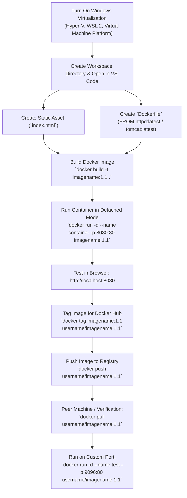

# Experiment 3: Application Containerization using Docker

**Practical / Lab Manual: Packaging Static Web Assets into an Apache Container & Distributing to a Container Registry**

---

## 1. Objective

To create a `Dockerfile` to package static web assets (`index.html`) into an Apache web server container (Apache HTTP Server `httpd` / Apache Tomcat), configure the container environment to serve HTML content, test and run the container locally, and distribute the finalized container image to a remote container registry (Docker Hub).

---

## 2. Environment & System Configuration

| Component | Configuration / Specification |
| :--- | :--- |
| **Operating System** | Windows 10/11 (with WSL 2 & Hyper-V) / macOS / Linux |
| **Container Engine** | Docker Desktop / Docker Engine |
| **Code Editor** | Visual Studio Code |
| **Base Container Image** | `httpd:latest` (Apache HTTP Server) / `tomcat:latest` (Apache Tomcat) |
| **Web Assets** | `index.html` |
| **Default Container Port** | Port `80` (for `httpd`) / Port `8080` (for `tomcat`) |
| **Host Port Mapping** | e.g., `8080:80`, `9096:80`, or custom port |
| **Container Registry** | Docker Hub (`https://hub.docker.com`) |

---

## 3. System Prerequisites and Windows Feature Setup

To run Docker Desktop on Windows, virtualization features must be enabled:

1. Open Windows Search and type **"Turn Windows features on or off"**.
2. Enable the following features:
   - **Hyper-V**
   - **Virtual Machine Platform**
   - **Windows Subsystem for Linux (WSL)**
3. Click **OK** and restart your computer if prompted.
4. Verify Docker installation in the terminal:

```bash
docker --version
docker compose version
```

---

## 4. Key Docker Flags & Terminology

* `-t, --tag`: Names and optionally tags an image in the format `'name:tag'`.
* `-d, --detach`: Runs the container in the background (detached mode) and prints the container ID.
* `-p, --publish`: Publishes/maps a container's port to the host machine (`HostPort:ContainerPort`).
* `--name`: Assigns a custom name to the running container.
* `.`: Specifies the build context (the current directory where the `Dockerfile` resides).

---

## 5. Step-by-Step Procedure

### Step 1: Open Code Editor & Create Project Files

Create a dedicated directory for the project and open it in VS Code:

```bash
mkdir docker-web-app
cd docker-web-app
code .
```

Inside the project directory, create two files:
1. `index.html`
2. `Dockerfile`

---

### Step 2: Create the Static Web Asset (`index.html`)

Create `index.html` and add sample HTML content to serve:

```html
<!DOCTYPE html>
<html lang="en">
<head>
    <meta charset="UTF-8">
    <meta name="viewport" content="width=device-width, initial-scale=1.0">
    <title>DevOps Docker Container Lab</title>
    <style>
        body {
            font-family: Arial, sans-serif;
            background: linear-gradient(135deg, #1e3c72, #2a5298);
            color: #ffffff;
            display: flex;
            justify-content: center;
            align-items: center;
            height: 100vh;
            margin: 0;
        }
        .card {
            background-color: rgba(255, 255, 255, 0.1);
            backdrop-filter: blur(10px);
            padding: 40px;
            border-radius: 12px;
            text-align: center;
            box-shadow: 0 8px 32px 0 rgba(0, 0, 0, 0.3);
        }
        h1 { margin-bottom: 10px; }
        p { color: #dcdcdc; }
    </style>
</head>
<body>
    <div class="card">
        <h1>Containerized Web Application</h1>
        <p>Experiment 3: Running inside an Apache Container using Docker</p>
        <p>Status: Successfully Deployed and Served!</p>
    </div>
</body>
</html>
```

---

### Step 3: Create the `Dockerfile`

#### Option A: Using Apache HTTP Server (`httpd:latest`) *(As per Lab Classroom Demonstration)*

In this configuration, `httpd` serves static HTML directly from its document root directory `/usr/local/apache2/htdocs/`:

```dockerfile
# Pull the latest official Apache HTTP Server image
FROM httpd:latest

# Copy static web assets into Apache's document root
COPY index.html /usr/local/apache2/htdocs/
```

#### Option B: Using Apache Tomcat (`tomcat:latest`) *(As per Syllabus Specification)*

If containerizing on an Apache Tomcat server, static assets are deployed into the Tomcat root web application directory `/usr/local/tomcat/webapps/ROOT/`:

```dockerfile
# Pull the latest official Apache Tomcat image
FROM tomcat:latest

# Copy static HTML into the ROOT webapp directory
COPY index.html /usr/local/tomcat/webapps/ROOT/index.html
```

> **Note:** Apache `httpd` listens on port `80` by default, whereas Apache `tomcat` listens on port `8080` by default.

---

### Step 4: Build the Docker Image

Build the container image using the `docker build` command:

```bash
docker build -t my-web-app:1.1 .
```

* `-t my-web-app:1.1`: Assigns the image name `my-web-app` with tag `1.1` (or `v1`).
* `.`: Indicates that the build context and `Dockerfile` are located in the current working directory.

#### Verify the Built Image:
```bash
docker images
```

---

### Step 5: Run the Docker Container

Instantiate and run a container from the newly built image:

```bash
docker run -d --name my-web-container -p 8080:80 my-web-app:1.1
```

* `-d`: Runs the container in detached mode (background).
* `--name my-web-container`: Assigns a readable container name.
* `-p 8080:80`: Maps host port `8080` to the container's Apache web server port `80`.
* `my-web-app:1.1`: The image name and tag to run.

#### Verify Running Container:
```bash
docker ps
```

---

### Step 6: Verify Web Application in Browser

Open any web browser and navigate to:
```text
http://localhost:8080
```
Verify that the `index.html` page renders properly with the custom styled card.

---

### Step 7: Tag the Image for Container Registry (Docker Hub)

To distribute an image, it must be tagged with your Docker Hub username:

1. Log in to your Docker Hub account via the terminal:

```bash
docker login
```

2. Tag the local image with your registry repository name:

```bash
docker tag my-web-app:1.1 <your-dockerhub-username>/my-web-app:1.1
```

*(Alternatively, you can tag by Image ID: `docker tag <IMAGE_ID> <your-dockerhub-username>/my-web-app:1.1`)*

---

### Step 8: Push the Image to the Container Registry

Upload the tagged container image to Docker Hub:

```bash
docker push <your-dockerhub-username>/my-web-app:1.1
```

#### Verification:
Log in to [Docker Hub](https://hub.docker.com) in your browser and verify that the repository `<your-dockerhub-username>/my-web-app` displays the uploaded tag `1.1`.

---

### Step 9: Pull and Run the Image on Another System / Peer Machine

To demonstrate the portability of the containerized application, pull and execute the image on a friend's computer or a second machine:

1. Pull the image from the public registry:

```bash
docker pull <friend-or-peer-username>/<imagename>
```

2. Run the pulled image with a custom host port mapping:

```bash
docker run -d --name peer-container -p 9096:80 <friend-or-peer-username>/<imagename>
```

3. Open the browser on the peer system and access:
```text
http://localhost:9096
```

---

## 6. Complete Lab Workflow



---

## 7. Useful Docker Commands Reference

| Command | Purpose |
| :--- | :--- |
| `docker build -t <name>:<tag> .` | Builds an image from the `Dockerfile` in the current directory |
| `docker run -d --name <name> -p <hPort>:<cPort> <image>` | Creates and starts a container in detached mode with port forwarding |
| `docker ps` | Lists all currently running containers |
| `docker ps -a` | Lists all containers (running and stopped) |
| `docker images` | Lists all locally stored Docker images |
| `docker stop <container_id_or_name>` | Stops a running container gracefully |
| `docker rm <container_id_or_name>` | Removes a stopped container |
| `docker rmi <image_id_or_name>` | Removes a local Docker image |
| `docker logs <container_name>` | Displays log output generated by a container |
| `docker tag <source_image> <target_image>` | Creates a new tag referencing an existing image |
| `docker push <username>/<image>:<tag>` | Uploads an image to Docker Hub or remote registry |
| `docker pull <username>/<image>:<tag>` | Downloads an image from Docker Hub or remote registry |

---

## 8. Troubleshooting

| Problem | Cause | Solution |
| :--- | :--- | :--- |
| **`docker: command not found`** | Docker Desktop is not installed or not added to system `PATH`. | Install Docker Desktop and ensure the path is set in environment variables. |
| **`error during connect: This error may indicate that the docker daemon is not running.`** | Docker Desktop application is closed or starting up. | Launch Docker Desktop from the Start menu and wait until the status displays "Engine running". |
| **`Bind for 0.0.0.0:8080 failed: port is already allocated`** | Another application or container is using host port `8080`. | Change the host port mapping in the command (e.g., `-p 8085:80` or `-p 9096:80`). |
| **`denied: requested access to the resource is denied` during push** | Not authenticated with Docker Hub or repository name does not match username. | Run `docker login` and ensure the image is tagged as `<your-dockerhub-username>/<imagename>`. |
| **Browser displays 404 Not Found** | HTML file was copied to the wrong directory inside the image. | For `httpd`, use `/usr/local/apache2/htdocs/`. For `tomcat`, use `/usr/local/tomcat/webapps/ROOT/`. |

---

## 9. Deliverables & Lab Submission Checklist

1. **Source Code**:
   - `index.html` file content.
   - `Dockerfile` configuration.
2. **Screenshots & Terminal Outputs**:
   - Terminal output of `docker build` command.
   - Terminal output of `docker images` showing the created image.
   - Terminal output of `docker run` and `docker ps`.
   - Browser screenshot showing the hosted web page at `http://localhost:<port>`.
   - Terminal output of `docker tag` and `docker push`.
   - Docker Hub repository page showing the pushed image tag.
   - Terminal output of `docker pull` and running the container on a peer machine/port (`9096:80`).

---

## 10. Learning Outcomes

After completing this experiment, students will be able to:
1. Explain the fundamentals of containerization and compare containers to virtual machines.
2. Formulate a multi-step `Dockerfile` with base images (`FROM`) and asset instructions (`COPY`).
3. Build, tag, and manage container images using the Docker CLI.
4. Manage container lifecycles including background execution (`-d`) and port publishing (`-p`).
5. Authenticate and publish container images to public cloud registries (Docker Hub).
6. Pull and deploy containerized web services reliably across heterogeneous environments.

