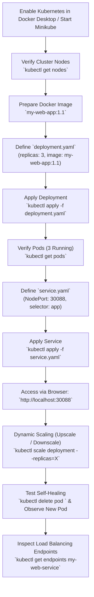

# Experiment 4: Container Orchestration and Scaling with Kubernetes

**Practical / Lab Manual: Deploying Containerized Applications, Automated Scaling, Load Balancing, and High Availability**

---

## 1. Objective

To deploy a containerized web application onto a Kubernetes cluster using declarative `Deployment` and `Service` (`NodePort`) manifests, configure port forwarding to expose the application to host traffic, manage dynamic horizontal scaling (upscaling and downscaling), inspect service endpoints for load balancing, and demonstrate Kubernetes self-healing and high availability.

---

## 2. Environment & System Configuration

| Component | Configuration / Specification |
| :--- | :--- |
| **Operating System** | Windows 10/11 (with WSL 2 & Hyper-V) / macOS / Linux |
| **Container Engine** | Docker Desktop (with Kubernetes enabled) / Minikube / Kubeadm |
| **Cluster Management CLI** | `kubectl` |
| **Code Editor** | Visual Studio Code |
| **Application Image** | `my-web-app:1.1` (built in Experiment 3 using `httpd` or `tomcat`) |
| **Kubernetes Objects** | `Deployment` (`apps/v1`), `Service` (`v1`) |
| **Service Type** | `NodePort` |
| **Allocated NodePort** | `30088` |
| **Initial Replicas** | `3` Pods |
| **Access URL** | `http://localhost:30088` |

---

## 3. System Requirements & Cluster Initialization

### Required Workspace Files:
```text
docker-k8s-lab/
├── index.html        # Web page content (from Exp 3)
├── Dockerfile        # Container image recipe (from Exp 3)
├── deployment.yaml   # Kubernetes Deployment manifest
└── service.yaml      # Kubernetes Service (NodePort) manifest
```

### Enabling Kubernetes:
1. **Docker Desktop**:
   - Open Docker Desktop **Settings** (gear icon).
   - Navigate to the **Kubernetes** tab.
   - Check **Enable Kubernetes** and click **Apply & restart**.
   - Wait until the bottom-left icon shows both Docker and Kubernetes as **running (green)**.
2. **Alternative (Minikube / Kubeadm)**:
   - If using Minikube: run `minikube start`.
   - If using Kubeadm: ensure your control-plane and worker nodes are in `Ready` status.

---

## 4. Key Kubernetes Concepts & Manifest Parameters

* **Pod**: The smallest deployable computing unit in Kubernetes, wrapping one or more containers.
* **Deployment**: Manages `ReplicaSets` and provides declarative updates for Pods (self-healing, rolling updates, scaling).
* **Service (`NodePort`)**: Exposes the Pods to external traffic by opening a specific port (`30000-32767`, here `30088`) on all cluster nodes.
* **Endpoints**: Tracks the internal IP addresses of all healthy Pods matching the Service's selector to distribute traffic evenly.
* **`imagePullPolicy: IfNotPresent`**: Instructs Kubernetes to use locally built Docker images before attempting to pull from Docker Hub.

---

## 5. Step-by-Step Procedure

### Step 1: Verify Kubernetes Cluster and Node Availability

Open the VS Code Integrated Terminal and verify the `kubectl` installation and cluster node status:

```bash
# Check kubectl client and cluster version
kubectl version --client

# Verify cluster connectivity
kubectl cluster-info

# Check the availability and health status of cluster nodes
kubectl get nodes
```

#### Expected Output:
```text
NAME             STATUS   ROLES           AGE   VERSION
docker-desktop   Ready    control-plane   10d   v1.30.x
```
> Confirm the node status is **Ready** before proceeding.

---

### Step 2: Verify Local Container Image (from Exp 3)

Ensure your container image from Experiment 3 is available locally in Docker:

```bash
docker images
```

If not already built, quickly build it in your project folder:

```bash
docker build -t my-web-app:1.1 .
```

---

### Step 3: Create the Deployment Manifest (`deployment.yaml`)

Create a file named `deployment.yaml` in VS Code to define the desired state of 3 running Pod replicas:

```yaml
apiVersion: apps/v1
kind: Deployment
metadata:
  name: my-web-app-deployment
  labels:
    app: my-web-app
spec:
  replicas: 3
  selector:
    matchLabels:
      app: my-web-app
  template:
    metadata:
      labels:
        app: my-web-app
    spec:
      containers:
      - name: my-web-container
        image: my-web-app:1.1
        imagePullPolicy: IfNotPresent
        ports:
        - containerPort: 80
```

> **Note on Image & Port:**
> * If you used Apache `httpd`, `containerPort` is `80`.
> * If you used Apache `tomcat`, change `containerPort` to `8080`.
> * `imagePullPolicy: IfNotPresent` ensures Docker Desktop Kubernetes uses your local image.

---

### Step 4: Apply and Inspect the Deployment

1. Apply the deployment manifest to the cluster:

```bash
kubectl apply -f deployment.yaml
```

2. Check the status of the deployment:

```bash
kubectl get deployments
```

3. List all running Pods managed by the deployment:

```bash
kubectl get pods -o wide
```

#### Expected Output:
```text
NAME                                     READY   STATUS    RESTARTS   AGE
my-web-app-deployment-6d4b8f5cb7-abc12   1/1     Running   0          25s
my-web-app-deployment-6d4b8f5cb7-def34   1/1     Running   0          25s
my-web-app-deployment-6d4b8f5cb7-ghi56   1/1     Running   0          25s
```
> All **3 Pods** should transition to the `Running` state.

---

### Step 5: Create the Service Manifest (`service.yaml`)

To expose the Pods outside the cluster so they can be reached via a web browser, create `service.yaml`:

```yaml
apiVersion: v1
kind: Service
metadata:
  name: my-web-service
  labels:
    app: my-web-app
spec:
  type: NodePort
  selector:
    app: my-web-app
  ports:
  - port: 80
    targetPort: 80
    nodePort: 30088
```

> **Configuration Details:**
> * `selector.app: my-web-app`: Matches the labels defined in `deployment.yaml`.
> * `port: 80`: The internal cluster port exposed by the service.
> * `targetPort: 80`: The target container port (use `8080` if Tomcat was used).
> * `nodePort: 30088`: The static port opened on the host node (`localhost`).

---

### Step 6: Apply the Service and Access the Application

1. Deploy the service to the cluster:

```bash
kubectl apply -f service.yaml
```

2. Verify that the service is running and properly bound to NodePort `30088`:

```bash
kubectl get services
```

#### Expected Output:
```text
NAME             TYPE        CLUSTER-IP       EXTERNAL-IP   PORT(S)        AGE
kubernetes       ClusterIP   10.96.0.1        <none>        443/TCP        10d
my-web-service   NodePort    10.105.210.45    <none>        80:30088/TCP   15s
```

3. **Open in Browser**:
   Open Google Chrome or any browser and navigate to:
   ```text
   http://localhost:30088
   ```
   The browser displays the `index.html` web application hosted across the Kubernetes Pods.

---

### Step 7: Automated Scaling (Horizontal Pod Scaling)

Scale the number of application replicas dynamically using the `kubectl scale` command:

#### A. Upscaling (Increase Replicas from 3 to 6):
```bash
kubectl scale deployment my-web-app-deployment --replicas=6
```

Verify newly provisioned Pods:
```bash
kubectl get pods
```
> You will observe 3 additional Pods being created and transitioning to `Running`.

#### B. Downscaling (Reduce Replicas to 2):
```bash
kubectl scale deployment my-web-app-deployment --replicas=2
```

Verify Pod termination:
```bash
kubectl get pods
```
> Excess Pods enter the `Terminating` state, leaving exactly 2 active Pods.

---

### Step 8: Demonstrating High Availability & Self-Healing

Kubernetes actively monitors Pod health. If a Pod crashes or is deleted, the Deployment controller automatically creates a replacement Pod to satisfy the desired replica count.

1. List the existing Pods to obtain a target Pod name:
```bash
kubectl get pods
```

2. Manually delete one of the Pods:
```bash
kubectl delete pod <pod-name>
```

3. Immediately check the Pod list:
```bash
kubectl get pods
```

#### Observation:
* The deleted Pod transitions to `Terminating`.
* Simultaneously, a **brand new Pod** with a unique suffix is generated automatically and reaches `Running` status within seconds, ensuring zero downtime and continuous service availability.

---

### Step 9: Inspect Service Endpoints and Load Balancing

The Service distributes incoming browser requests across all healthy Pod replicas. Inspect the registered backend Pod IP addresses managed by the service:

```bash
kubectl get endpoints my-web-service
```

#### Expected Output:
```text
NAME             ENDPOINTS                                         AGE
my-web-service   10.1.0.45:80,10.1.0.46:80,10.1.0.47:80           5m
```
> Each endpoint corresponds to an active Pod IP address, demonstrating automatic cluster-level load balancing.

---

## 6. Complete Lab Workflow



---

## 7. Useful `kubectl` Commands Reference

| Command | Purpose |
| :--- | :--- |
| `kubectl get nodes` | Lists all nodes in the cluster with status and roles |
| `kubectl apply -f <file.yaml>` | Creates or updates Kubernetes resources from a manifest file |
| `kubectl get deployments` | Displays status and replica summary of all Deployments |
| `kubectl get pods -o wide` | Lists all Pods with detailed information (IP, Node assigned) |
| `kubectl get services` | Lists all Services along with ClusterIP and NodePort mappings |
| `kubectl describe pod <pod-name>` | Shows detailed configuration, events, and troubleshooting logs for a Pod |
| `kubectl logs <pod-name>` | Prints container logs from a specific Pod |
| `kubectl scale deployment <name> --replicas=<num>` | Scales the replica count of a Deployment up or down |
| `kubectl delete pod <pod-name>` | Deletes a Pod to test self-healing resilience |
| `kubectl get endpoints <service-name>` | Lists all active target Pod IP addresses registered to the Service |
| `kubectl delete -f <file.yaml>` | Tears down all resources declared in the manifest file |

---

## 8. Troubleshooting Guide

| Issue / Error | Probable Cause | Recommended Solution |
| :--- | :--- | :--- |
| **`ErrImageNeverPull` or `ImagePullBackOff`** | The image was not found locally or Kubernetes tried pulling from remote Docker Hub. | Add `imagePullPolicy: IfNotPresent` to `deployment.yaml` and verify the image exists in `docker images`. |
| **`The connection to the server localhost:8080 was refused`** | Kubernetes cluster / Docker Desktop daemon is not running. | Open Docker Desktop and verify Kubernetes status icon is green. |
| **Browser cannot connect to `http://localhost:30088`** | `service.yaml` has incorrect port mapping or wrong selector label. | Ensure `spec.selector` in `service.yaml` matches `spec.template.metadata.labels` in `deployment.yaml`. |
| **Pods remain in `Pending` state** | Insufficient CPU/Memory resources on host machine or node is `NotReady`. | Check node status via `kubectl get nodes` and inspect events via `kubectl describe pod <pod-name>`. |
| **`NodePort: port is already allocated`** | Port `30088` is being used by another service in the cluster. | Pick another free port in the valid range `30000-32767` (e.g., `30090`). |

---

## 9. Deliverables & Lab Submission Checklist

1. **Manifest Files**:
   - [`deployment.yaml`](file:///Users/karthikm/Desktop/devops/exp4.md#L97-L119) with Pod templates and labels.
   - [`service.yaml`](file:///Users/karthikm/Desktop/devops/exp4.md#L152-L167) specifying `type: NodePort` and `nodePort: 30088`.
2. **Terminal Outputs & Screenshots to Attach**:
   - Output of `kubectl get nodes` displaying `Ready` status.
   - Output of `kubectl apply -f deployment.yaml` and `kubectl get deployments`.
   - Output of `kubectl get pods` displaying 3 initial pods in `Running` state.
   - Output of `kubectl get services` showing NodePort `30088` binding.
   - Screenshot of Google Chrome browser successfully loading `http://localhost:30088`.
   - Output of `kubectl scale` showing scaled Pod count (upscaled to 6, downscaled to 2).
   - Screenshot demonstrating self-healing: deleting a pod with `kubectl delete pod` and observing the immediate recreation of a new Pod.
   - Output of `kubectl get endpoints my-web-service`.

---

## 10. Learning Outcomes

By performing this experiment, students have gained hands-on competencies to:
1. Initialize, inspect, and interact with a local Kubernetes cluster using the `kubectl` CLI.
2. Structure production-standard declarative YAML manifests for `Deployment` and `Service` resources.
3. Expose microservices and containerized workloads to external networks using the `NodePort` mechanism.
4. Dynamically adjust workload capacity through horizontal replica scaling without downtime.
5. Validate the self-healing and fault-tolerant architecture of Kubernetes pod reconciliation loops.
6. Trace service discovery, endpoint registration, and cluster-internal load distribution across active pods.
